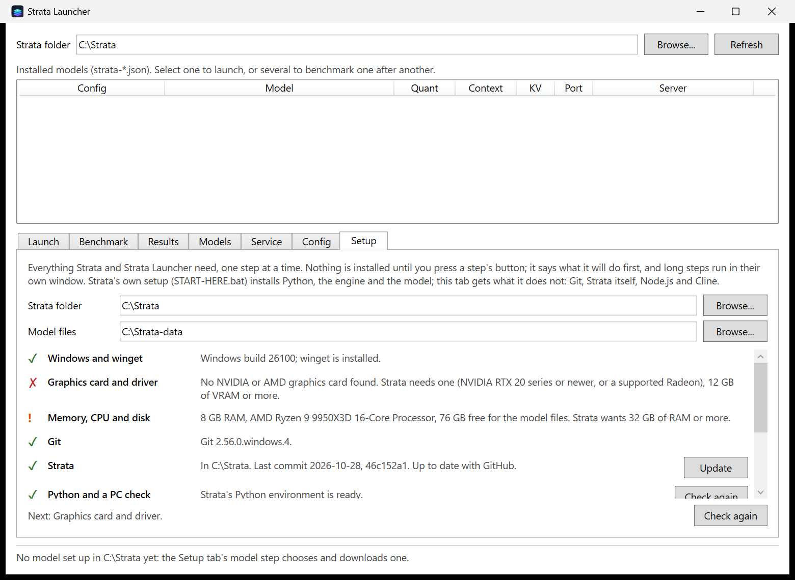

<p align="center">
  
</p>

<h1 align="center">Strata Launcher</h1>

<p align="center">
  Set up, run, benchmark and tune <a href="https://github.com/Niko1221/Strata">Strata</a> on Windows —<br>
  from a brand-new PC to Cline coding against your local model.
</p>

<p align="center">
  <a href="https://github.com/b1tninja/strata-launcher/releases/latest/download/strata-launcher-setup.cmd"><b>⬇ Download the setup (Windows 10 / 11)</b></a>
</p>

<p align="center">
  
</p>

## Install

1. **[Download `strata-launcher-setup.cmd`](https://github.com/b1tninja/strata-launcher/releases/latest/download/strata-launcher-setup.cmd)** and double-click it.
   Windows asks once whether to run a file from the internet: choose **Run** (on a SmartScreen
   page, **More info › Run anyway**).
2. Strata Launcher opens and asks **where Strata is**. Pick a Strata folder it found, or choose an
   empty folder and it downloads Strata there.
3. The **Setup** tab lists what this PC still needs and fetches each piece with one button.

No administrator rights are needed, and nothing is installed before you press a button. Prefer a
terminal? This one line does the same:

```powershell
irm https://raw.githubusercontent.com/b1tninja/strata-launcher/main/install.ps1 | iex
```

Run either again to update. [Uninstall](docs/setup.md#uninstall) is one line too.

## What you get

- **Setup on a clean PC.** Strata, Git, Python (through [uv](https://github.com/astral-sh/uv), in
  seconds), a model, Node.js and Cline, each with or without winget. Tested on a clean Windows in
  Windows Sandbox. [Details](docs/setup.md)
- **Start and stop models** one at a time, with per-launch context, rope scaling and VRAM overrides
  that never touch your config files.
- **Benchmarks** of one or several models in turn, and a results table to compare runs.
- **A model catalog** with each model's disk and RAM needs against this PC.
- **A config editor** for Strata's `strata-*.json`, with explanations and a backup on save.
- **Sessions:** save the conversation the engine holds to disk and resume it later, even after a
  restart.
- **A background service** that loads a model on the first request and unloads it when idle.
- **Cline, set up right:** opens Cline against the running model with a context limit it can
  actually compact against. [Why that matters](docs/using.md#cline)

[Using Strata Launcher](docs/using.md) · [Troubleshooting](docs/troubleshooting.md) ·
[Contributing and tests](CONTRIBUTING.md)

## How it fits with Strata

Strata runs the Qwen3.8-Flash-Next family of models locally on one graphics card plus system RAM,
and has its own [desktop app and terminal app](https://github.com/Niko1221/Strata/releases/latest).
Strata Launcher works with a Strata folder (a clone or Strata's zip, driven through its own
`START-HERE.bat`, `UPDATE.bat` and configs) and adds the tools around it: benchmarking, the config
editor, sessions, the idle service and Cline.

It is a single PowerShell script with a native Windows window, running on the Windows PowerShell
5.1 that every Windows 10 and 11 has: nothing to build. It is Windows-only; Strata itself also runs
on Linux and macOS.
